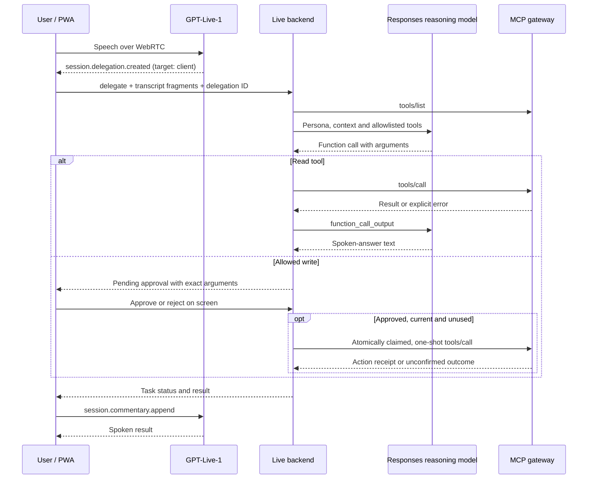

# Zo Voice AI Assistant


A voice interface for [Zo Computer](https://zo.computer) personas with **GPT-Live-1**, **OpenAI Realtime**, and **Classic speech → text → speech** modes. Speak or type to your assistant, retrieve saved memories and workspace knowledge, and review supported actions before execution.

Built as a Progressive Web App (PWA) deployed to your `zo.space`. Works with any of your Zo personas — pick from the dropdown at runtime.

---

## Architecture

### Choose a conversation mode

| Mode | Conversation | Tool execution |
|---|---|---|
| **Realtime** (default) | OpenAI Realtime over WebRTC | OpenAI calls the MCP gateway directly; the selected tool pack controls availability and write approvals. |
| **GPT-Live** (opt-in) | `gpt-live-1` over WebRTC | Client delegation sends work to the authenticated Live backend, which uses a text reasoning model and a restricted MCP tool list. |
| **Classic** | Browser speech recognition or typed text → Zo Ask → TTS | Zo Ask handles the request; ElevenLabs, OpenAI TTS, Edge or browser speech plays the reply. |

### Start GPT-Live-1

In Settings, choose **GPT-Live**, save, and select **Start conversation**. Realtime remains the default; Classic remains available. GPT-Live uses `gpt-live-1` over WebRTC with client delegation to the authenticated `/api/<slug>-live` route. The backend uses `gpt-5.6-luna` by default (`VOICE_LIVE_BACKEND_MODEL` overrides it), the selected persona prompt, transcript timestamps, prior task records and the existing MCP gateway.

Choose from 13 built-in voices (Marin by default) and four delivery styles: Natural, Calm and measured, Warm and friendly, or Brisk and clear. Voice/style preferences persist in this browser and apply to the next conversation; saving only those preferences keeps an active call running. Changing mode or persona ends it. Approved OpenAI custom voices can be configured by the operator; third-party voice IDs and voice packs cannot be imported. See [voice configuration](docs/live-voices.md).

### GPT-Live tool-calling workflow



The browser forwards timestamped transcript fragments; the backend owns tool selection, execution and task state. It filters `tools/list` through a server allowlist, validates each function name again before execution, disables parallel calls, and bounds reasoning to six steps and a 90-second run deadline. Repeated delegation IDs return the existing task instead of starting it again. Results are sent back to Live with the matching delegation ID; typed requests in a connected GPT-Live call use the same backend with their own task IDs.

Allowed reads cover the live clock, memory, open loops, RAG, bounded workspace search, agent/automation listings, calendar and Gmail reads, Linear, GitHub, Factory, Drive search, and web research. **Only `send_sms` and `calendar_create_event` are allowed writes.** Email sending, unrestricted agent delegation, shell commands, arbitrary file reads and deployment tools are unavailable in GPT-Live mode. Realtime retains its separate tool packs.

### Approvals, cancellation and session recovery

GPT-Live shows the exact tool name and arguments for an on-screen Approve/Reject decision. A spoken “yes” does not approve a write. Approvals expire after two minutes or when the user transcript changes. The server atomically claims an approved action before calling the gateway; duplicate clicks cannot execute it twice. A missing receipt or timeout stays **unconfirmed** and is never automatically replayed.

**Cancel task** cancels pending work; an action already executing may still finish. Speech interruptions do not cancel actions. Closing a session cancels pending work and approvals. Resuming carries prior context and task outcomes into a new session without replaying unexecuted approvals.

Live requires an owner-signed-in private Zo page. The API verifies the browser cookie against that fixed private page in addition to the existing HMAC token; an Origin header or bootstrap token alone cannot authorize a Live session. Requests use the private page's same-origin endpoint. If Zo cannot verify the session cookie, access fails closed.

Each Live conversation also receives a server-signed session reference, saved in sessionStorage and sent with subsequent requests. This preserves conversation and approval ownership when browser cookies change, while still requiring owner sign-in on every request. Existing sessions can obtain a reference using their original authenticated cookie. If a saved reference is unavailable, Start conversation clears that browser reference and starts fresh once, without replaying prior actions. Authentication failures, server errors and uncertain action results never trigger this recovery.

Task and approval records persist locally at `/home/workspace/.zo/voice/<slug>-live.sqlite` (`VOICE_LIVE_DB_PATH` overrides this). Protect this file: it contains private transcripts, persona prompts and task results. Live and Responses requests set `store: false`; this is not a claim that the local application retains no conversation data.

Use **End conversation** to disconnect. Live waits briefly for final usage before releasing the connection and also requests server-side hangup. Sessions end after 30 minutes or five minutes without user speech. Live audio and backend reasoning incur separate usage; consult [OpenAI pricing](https://developers.openai.com/api/docs/pricing) for current rates. Background-noise sensitivity and audio quality should be checked on the actual microphone and network.

Persona startup prefers `ZO_ASK_TOKEN` and falls back to `ZO_API_KEY` on transport, HTTP, JSON-RPC or tool errors. Each attempt has a 25-second deadline within a 35-second total lookup budget. Successful Live persona catalogs are cached for five minutes, concurrent starts share a lookup, and credential changes invalidate the cache. Expired or unavailable persona data fails closed before contacting OpenAI; the user receives a retry message. The persona dropdown uses the same credential order and timeout bounds and accepts both structured and legacy string records.

### Memory, RAG and current-time tools

Both voice engines use the same gateway retrieval implementations. The reasoning instructions choose the tool according to the question:

| Need | Tool | Result and boundary |
|---|---|---|
| Saved preferences or prior decisions | `memory_search` | Structured SQLite facts with sources and dates; respects scope, expiry and withholding. |
| Unfinished work | `list_open_loops` | Typed open-loop records, retaining fields such as status and priority. |
| Document knowledge or paraphrased concepts | `rag_search` | Sourced passages from the configured Qdrant index. Indexed copies are historical evidence. |
| Available semantic collections | `rag_list_collections` | Exact collection names for scoped retrieval. |
| Literal file/content fallback | `workspace_search` | Optional directory scope, a six-second deadline and explicit partial-result status. |
| Current date or time in a city | `get_current_time` | Fresh server timestamp, IANA zone, local date/time and daylight-saving offset. |

When memory has no useful matches, instructions direct the backend to try RAG and then workspace search. This is model-guided routing, not an automatic database cascade. A retrieval failure is distinct from zero matches. RAG calls the canonical local Qdrant MCP implementation (`VOICE_RAG_MCP_PATH` can override its entrypoint); deployment does not install that service or populate indexes. Workspace search excludes hidden files, symlinks, Trash, dependencies, build output and copied worktrees; content search limits files to 1 MB and three matches per file. Tool failures and timeouts return errors, never success or a promise of an unscheduled follow-up.

Current-time and date questions use `get_current_time`, an authenticated local server-clock tool in every Realtime pack and the Live delegation allowlist. It returns a fresh timestamp, requested IANA zone, local date/time and daylight-saving offset without an upstream service. Los Angeles uses `America/Los_Angeles`; Arizona is the default only when no location is requested. Invalid or ambiguous zones return an error. Instructions require a fresh call for corrections and repeated time questions, and prohibit treating search snippets or previous answers as a live clock. End and start a conversation after deployment to load the new session instructions.

Protocol references: [WebRTC](https://developers.openai.com/api/docs/guides/voice-webrtc?api=live), [client delegation](https://developers.openai.com/api/docs/guides/live-delegation), [session lifecycle](https://developers.openai.com/api/docs/guides/live-conversations).


At a glance:

1. **Speak naturally** using your microphone.
2. **Your assistant listens and responds** in real time.
3. **Zo tools help when needed** with memory, Gmail, Google Calendar, Linear projects, email, and files.
4. **You hear the result.** Supported write approvals depend on the mode and tool.

The technical routes and tool packs are documented below for readers who need implementation details.

### Realtime native MCP workflow and tool packs

For spoken Realtime requests, `/api/realtime-session` returns the MCP configuration with `allowed_tools` and `require_approval`. OpenAI discovers tools through `/api/<slug>-mcp` and calls that gateway directly. The PWA displays tool progress and handles `mcp_approval_request` with a browser confirmation of the exact arguments, then sends `mcp_approval_response`. Selected read-only tools have bounded transient retries; mutating calls stay one-shot. GPT-Live does not inherit these broader packs.

Typed messages in Realtime and Classic use `/api/<slug>-ask` and `/api/tts`, rather than the spoken Realtime MCP path. Both endpoints permit the PWA's authentication header during CORS preflight so the browser can receive text and reply audio.

| Pack | Tools | `require_approval` |
|------|-------|--------------------|
| `essentials` | 31 — live clock, memory, RAG, Gmail read, Calendar read, Linear projects + issue detail, factory status + run details, GitHub status, Drive search, service logs, Alaric read-only delegate, email/SMS send, file read, web search | per-tool: email/SMS writes `always`, reads `never` |
| `power` | 38 — adds image search/gen, transcription, calendar create | email/SMS `always`; other tools `never` |
| `power_with_writes` | 46 — adds agent/automation/route writes, persona switch, publish | email/SMS and configured agent/automation/route/persona/publish tools `always`; other tools `never` |

Realtime's current approval list does not include `calendar_create_event` or `generate_image`; they can run without an approval prompt in packs that expose them. GPT-Live independently requires approval for calendar creation and does not expose image generation.

---

## Routes deployed by `deploy-tts-endpoint.ts --deploy-all`

The `<slug>` is derived from `--name` (e.g. `--name "Aria"` → `aria-*`). Defaults to `voice` if no name is given. The `<path>` is `--path` (default `/ai-assistant-voice`).

| Route | Type | Purpose |
|-------|------|---------|
| `/api/tts` | api | TTS proxy (ElevenLabs / OpenAI / edge-tts backends) |
| `/api/<slug>-ask` | api | Text-mode Zo Ask proxy (fallback for non-Realtime mode) |
| `/api/<slug>-bootstrap` | api | HMAC session token issuer (24h TTL) |
| `/api/realtime-session` | api | OpenAI Realtime session mint + MCP tool config |
| `/api/<slug>-mcp` | api | JSON-RPC 2.0 MCP server, 46 tools, 3-tier auth |
| `/api/<slug>-personas` | api | Dynamic persona catalog — `list_personas` MCP (HMAC + ETag) |
| `/api/<slug>-live` | api | Optional GPT-Live session, delegation, approvals and durable task state |
| `<path>` | page | The React PWA |
| `<path>/manifest` | api | PWA install manifest |
| `<path>/sw` | api | Service worker (offline shell) |

---

## Requirements

- A [Zo Computer](https://zo.computer) account
- [Bun](https://bun.sh) runtime (pre-installed on Zo)
- Zo Secrets (Settings → Advanced → Secrets):
  - `ZO_ASK_TOKEN` — HMAC secret + Zo Ask proxy auth
  - `ZO_API_KEY` — used by `/api/<slug>-mcp` + `/api/<slug>-personas` to call upstream Zo MCP
  - `MCP_SHARED_TOKEN` — shared secret for OpenAI Realtime → MCP (`openssl rand -hex 32`). The env-var **name** is configurable; pass `--mcp-token-secret YOUR_NAME` to the deploy script to rename it (e.g. `ARIA_MCP_TOKEN`).
  - `OPENAI_API_KEY` — for Realtime sessions, GPT-Live sessions, Responses delegation and the OpenAI TTS backend; the project must have access to the selected models
  - `LINEAR_API_KEY` — read-only access to Linear project status and recent issue updates
  - `ELEVENLABS_API_KEY` — only if using ElevenLabs TTS backend (optional)
  - `MEMORY_DB_PATH` — *optional.* Absolute path to the SQLite memory backend. Default `/home/workspace/.zo/memory/shared-facts.db`. A missing backend returns an explicit retrieval error; other tools remain available.

Optional server configuration (set in the environment, not the browser):

| Variable | Default / purpose |
|---|---|
| `VOICE_LIVE_BACKEND_MODEL` | `gpt-5.6-luna`; Responses-compatible reasoning/tool model. |
| `VOICE_LIVE_DB_PATH` | `/home/workspace/.zo/voice/<slug>-live.sqlite`; writable, persistent task and approval state. |
| `VOICE_LIVE_CUSTOM_VOICES` | Unset; operator-approved OpenAI voice catalog. See [configuration and eligibility](docs/live-voices.md). |
| `VOICE_RAG_MCP_PATH` | Local Qdrant MCP entrypoint override; requires a working service and populated indexes. |

---

## Installation

### 1. Clone

```bash
git clone https://github.com/marlandoj/ai-assistant-voice.git \
  /home/workspace/Skills/ai-assistant-voice
```

Or, in natural language to your Zo: *"Install the ai-assistant-voice skill from GitHub and set it up."*

### 2. Set secrets

In Zo Computer → Settings → Advanced → Secrets:
- Create an access token, save it as `ZO_ASK_TOKEN`
- Save your `ZO_API_KEY`, `OPENAI_API_KEY`
- Generate the MCP shared secret: `openssl rand -hex 32`, save as `MCP_SHARED_TOKEN` (or any name you prefer — see step 3)

### 3. Deploy

```bash
bun /home/workspace/Skills/ai-assistant-voice/scripts/deploy-tts-endpoint.ts --deploy-all
```

Default backend is ElevenLabs. Use `--backend openai` or `--backend edge` to switch.

**Rename the MCP token secret** (optional). The shared-secret env var defaults to `MCP_SHARED_TOKEN`. To use a custom name, pass `--mcp-token-secret`:

```bash
bun /home/workspace/Skills/ai-assistant-voice/scripts/deploy-tts-endpoint.ts \
  --deploy-all \
  --name "Aria" \
  --mcp-token-secret "ARIA_MCP_TOKEN"
```

The flag value is upper-cased and sanitized to `[A-Z0-9_]`. Save your generated secret under whatever name you pass — both the MCP server route and the Realtime session route will read `process.env[<that name>]`.

### 4. Open the PWA

Visit `https://yourhandle.zo.space<path>` (default `/ai-assistant-voice`, private — sign in to view). Pick a persona from the dropdown (populated dynamically from your own Zo personas), tap the mic, talk.

### 5. Install to phone (optional)

Open in Chrome/Safari on mobile → "Add to Home Screen." Launches full-screen with offline shell.

---

## v3.2.0 — Latency & naturalness tunings

Five production improvements sourced from Bhargava/Together AI's *"Engineering voice agents"* talk, applied to `realtime-session-route.ts` and `pwa-page.tsx`:

| # | Feature | Effect |
|---|---------|--------|
| 1 | **Semantic VAD** | Distinguishes a thinking pause from end-of-turn — stops the model from cutting you off mid-thought |
| 2 | **Full-duplex barge-in** | Model stops the instant you start speaking — natural interruption, no half-second lag |
| 3 | **Thinker-talker back-channel** | Silent on fast tool calls; one brief acknowledgment ("One moment.") on slow ones — eliminates dead air without over-narrating |
| 4 | **Voice delivery suffix** | Pronunciation guidance + emotional register injected into every session — more consistent, expressive tone |
| 5 | **Latency observability** | `[latency] time-to-first-audio: Xms` + per-tool-call ms logged to console — pinpoint where delays come from |

No config changes needed — redeploy with `deploy-tts-endpoint.ts --deploy-all` to pick up all five.

---

## TTS backend comparison

| Backend | Voice quality | Cost | API key |
|---------|--------------|------|---------|
| ⭐ ElevenLabs | Best — natural, expressive | ~$0.30 / 1K chars | `ELEVENLABS_API_KEY` |
| OpenAI TTS | Very good — 6 voices | ~$0.015 / 1K chars | `OPENAI_API_KEY` |
| edge-tts | Good — 300+ neural voices | Free | none |
| Browser SpeechSynthesis | Basic | Free | none (fallback) |

In **Realtime** and **GPT-Live**, OpenAI handles conversational audio directly via WebRTC. External TTS voices apply to Classic and Zo Ask text-reply playback, not to the GPT-Live voice selector.

---

## Repository layout

```
Skills/ai-assistant-voice/
├── assets/
│   ├── alaric-bootstrap-route.ts     # HMAC token issuer (template)
│   ├── alaric-mcp-route.ts           # Shared MCP tools, memory, RAG and live clock
│   ├── alaric-personas-route.ts      # Dynamic persona catalog via list_personas (template)
│   ├── ai-ask-route.ts               # Text-mode Zo Ask proxy
│   ├── realtime-session-route.ts     # OpenAI Realtime mint
│   ├── live-route.ts                 # GPT-Live sessions and approved delegation
│   ├── pwa-page.tsx                  # React PWA (placeholderized)
│   ├── manifest-route.ts             # PWA manifest
│   ├── sw-route.ts                   # Service worker
│   ├── tts-route.ts                  # ElevenLabs TTS
│   ├── tts-route-openai.ts           # OpenAI TTS
│   ├── tts-route-edge.ts             # edge-tts
│   └── zo-ask-route.ts               # Legacy (used by v1 vanilla pwa/)
├── scripts/
│   ├── deploy-tts-endpoint.ts        # Deploys all routes
│   ├── ai-assistant-voice.ts         # CLI: voice configs, TTS test
│   └── setup-edge-tts.sh             # One-time edge-tts install
├── pwa/                              # v1 vanilla JS shell (legacy)
└── docs/
    ├── alaric-voice-v3-architecture.png
    └── alaric-voice-v3-architecture.svg
```

---

## CLI

```bash
cd /home/workspace/Skills/ai-assistant-voice/scripts

bun ai-assistant-voice.ts voices                    # List ElevenLabs voices
bun ai-assistant-voice.ts config set \
  --persona <persona-id> --name "My Assistant" --voice ErXwobaYiN019PkySvjV
bun ai-assistant-voice.ts config list
bun ai-assistant-voice.ts speak "Hello, Sir." --voice ErXwobaYiN019PkySvjV
```

Configs at `~/.zo/voice/persona-voices.json`.

---

## Customizing the assistant image

Default avatar is a holographic AI face at `/images/ai-assistant-portrait.png`. To replace:

Ask Zo: *"Change the AI assistant avatar to [description]"* — it'll generate and upload.

Or manually: replace the asset at `/images/ai-assistant-portrait.png` on your zo.space.

The image is displayed as a 260×260 circle with an animated glow when speaking.

---

## Configuring assistant identity

The skill is brand-neutral. Every public-facing identity surface is configured at deploy time via flags.

```bash
bun /home/workspace/Skills/ai-assistant-voice/scripts/deploy-tts-endpoint.ts \
  --deploy-all \
  --host yourhandle.zo.space \
  --name "Nova" \
  --path "/nova" \
  --persona-id "<your-persona-uuid>" \
  --default-voice "shimmer"
```

| Flag | Default | Effect |
|------|---------|--------|
| `--name` | `My Assistant` | Display name in UI; sets `<slug>` for route paths (`/api/<slug>-*`) |
| `--path` | `/ai-assistant-voice` | URL path for the PWA page |
| `--persona-id` | *(none)* | Default persona — usually one of your own from [Settings → AI → Personas](/?t=settings&s=ai&d=personas) |
| `--default-voice` | `alloy` | Fallback OpenAI voice when the persona has none configured |
| `--host` | Auto-detected | Override Zo Space hostname |

Placeholders substituted at deploy time across every route + the PWA page:
`{{ASSISTANT_NAME}}`, `{{ASSISTANT_SLUG}}`, `{{ZO_HOST}}`, `{{PAGE_PATH}}`, `{{DEFAULT_PERSONA_ID}}`, `{{DEFAULT_VOICE}}`, `{{PORTRAIT_PATH}}`, `{{PERSONAS_JSON}}`.

The persona dropdown is populated **dynamically** — `/api/<slug>-personas` calls the upstream `list_personas` MCP tool on every request (5-min ETag cache), so each fork sees its own personas with zero hardcoded UUIDs.

---

## GPT-Live voice preferences

GPT-Live has a dedicated voice selector and independent speaking-style preference. Choices are saved per browser and apply to the next conversation without ending the current call. See [GPT-Live voices](docs/live-voices.md) for the supported built-in catalog and operator configuration of approved OpenAI custom voices. Classic external TTS and Realtime voice mapping remain separate.

## Validation and troubleshooting

Run from the repository root on Zo:

```bash
bun test tests/live-route.test.ts tests/retrieval.test.ts tests/persona-startup.test.ts tests/clock.test.ts tests/typed-message.test.ts
tsc --noEmit
```

The checked-in TypeScript configuration resolves React, Hono and Bun types from `/__substrate/space/node_modules` without modifying that installation. A non-Zo development environment must supply equivalent dependencies and adjust those paths. Tests use isolated fixtures; they do not prove OpenAI account access or microphone quality.

| Symptom | Check |
|---|---|
| `owner_sign_in_required` | Open the private page and sign in to Zo; a bootstrap token alone cannot authorize GPT-Live. |
| `session_not_found` after a reload | Start conversation performs one stale-reference recovery. Authentication errors and server failures do not trigger automatic retries. |
| Startup returns `persona_unavailable` or a 502 | Check the persona service and OpenAI response. Persona lookup has bounded credential fallback; do not assume every 502 has the same cause. |
| Voice selection is rejected | Refresh the available catalog and choose an authorized voice; external provider IDs are unsupported. |
| Memory/RAG fails | Check the SQLite path, Qdrant MCP entrypoint and populated collections. A service failure does not prove the information is absent. |
| Wrong city time | End and start the conversation to load current instructions; confirm a fresh `get_current_time` call uses the requested IANA zone. |
| Typed text or reply audio is blocked | Verify both Ask and TTS preflight responses allow the configured `X-<assistant-name>-Auth` header. |
| An action is unconfirmed | Check the destination's actual state before requesting it again. Do not infer failure or resend automatically. |

Deployment verification included real gateway memory/RAG/clock results, real OpenAI session creation and browser text/audio delivery. The owner also confirmed a successful spoken GPT-Live conversation. Those observations do not replace a fresh microphone check after future transport changes.

## License

MIT
